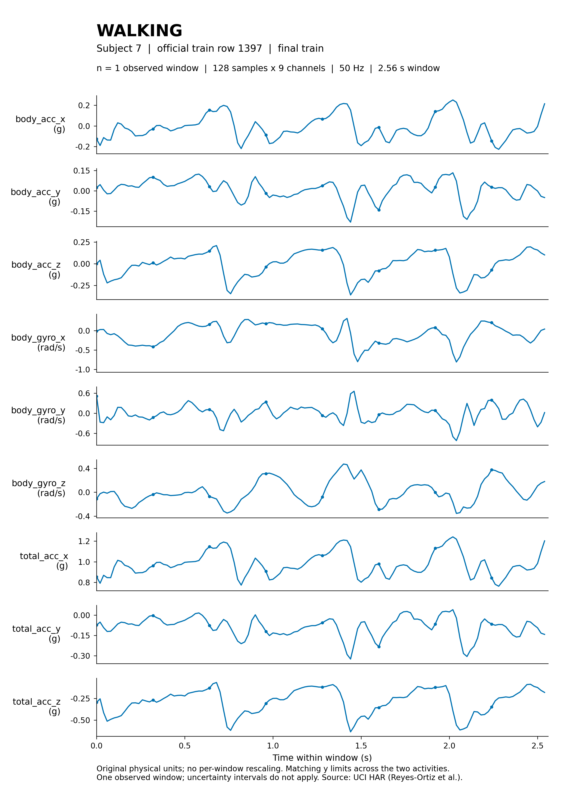
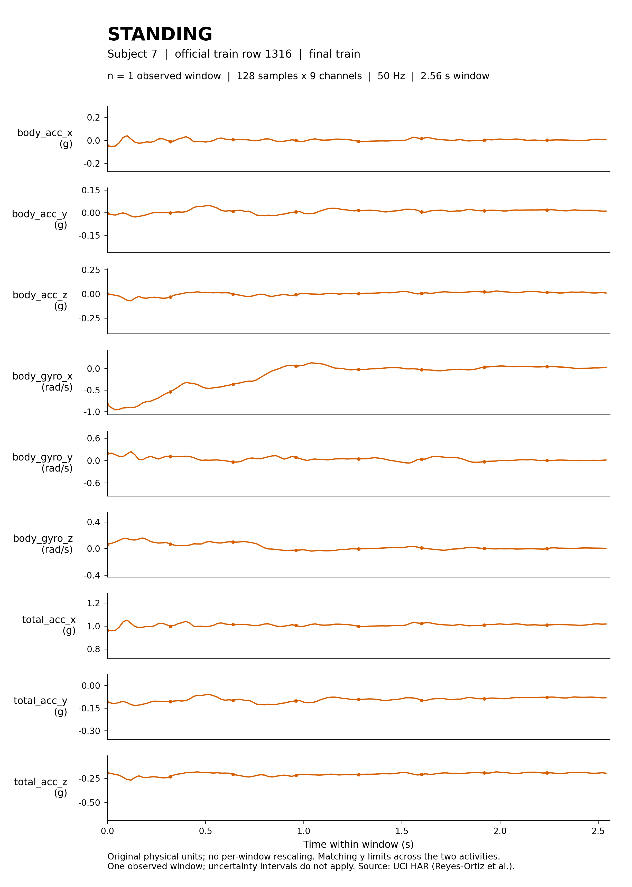
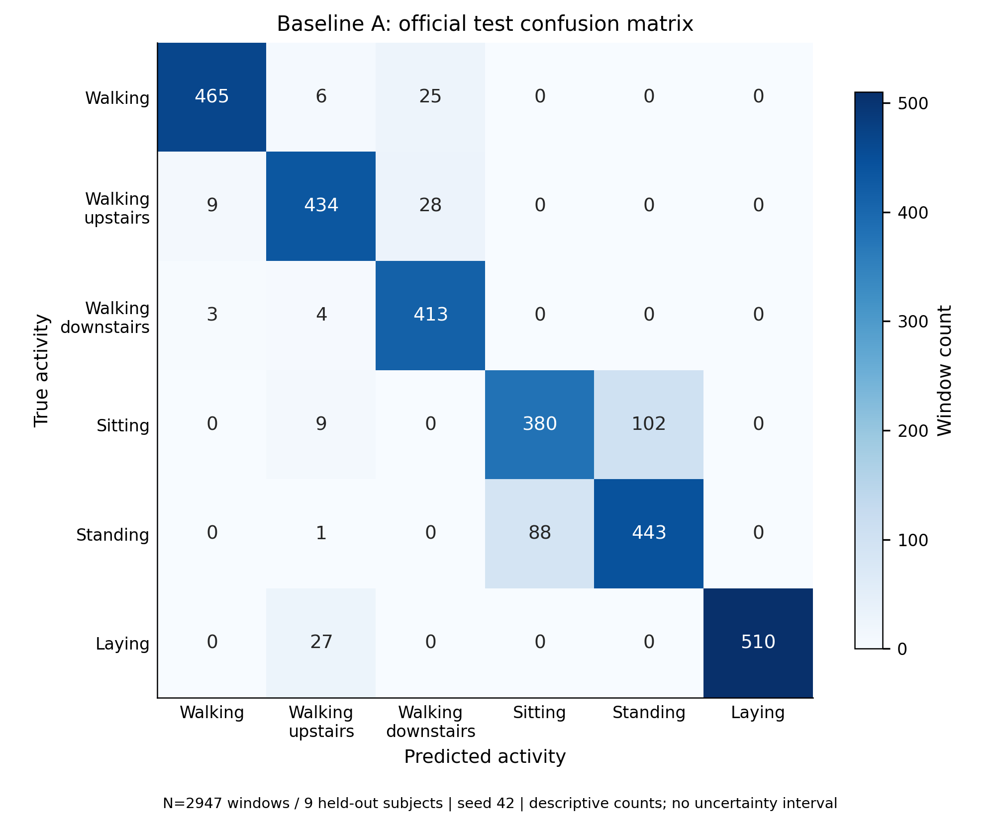

# SequenceModel-HAR-Lab

**跨受试者人体活动识别 · 可追溯的数据准备与序列模型实验**

简体中文 · [English](README.en.md)

[](https://github.com/wzhikun-helper/SequenceModel-HAR-Lab/actions/workflows/docs.yml)

基于 UCI HAR 手机传感器信号，研究多通道时序数据的表示、预处理与独立评价。已完成Day 01数据基础，并用真实训练窗口运行两层1D CNN的前向、反向与未训练权重重载检查。现已完成CNN Baseline A Seed42正式训练，GRU Baseline B也已完成固定条件下的单种子训练，Transformer Baseline C也已完成；Mamba及消融未执行。

**128 × 9** 每窗口输入 · **50 Hz** 采样率 · **6** 类活动 · **30** 位受试者

[复现指南](docs/reproducing_day01.md) · [数据协议](docs/data_protocol.md) · [文档导航](docs/README.md) · [项目进度](PROGRESS.md) · [更新记录](CHANGELOG.md)

## 项目内容

| 已完成 | 实现与证据 |
| --- | --- |
| 官方数据获取 | UCI来源、ZIP成员CRC、本地SHA-256、安全解压 |
| 窗口与标签审计 | 全部18路信号文件、10,299个窗口、六类活动与受试者ID |
| 跨受试者协议 | 训练17人、验证4人、测试9人；保留官方测试集 |
| 标准化与复核 | 仅最终训练集拟合；独立复核保存数组与原始行的对应关系 |
| CNN最小工程 | 六个真实训练窗口、27,270参数、一次反向、checkpoint重载输出一致；不含优化器更新 |

[数据审计报告](reports/day01_data_20261026_run02/day01_data_audit.md) · [独立复核结果](reports/day01_data_20261026_run02/independent_verification.json)

## 数据协议

使用官方已预处理的九路 `Inertial Signals`，保留时间顺序；不把561维工程特征当作序列输入。数组布局为 **N × 128 × 9**，标签保留官方1—6。

| 集合 | 人数 | 窗口数 | 划分规则 |
| --- | ---: | ---: | --- |
| 训练 | 17 | 6,037 | 官方训练人员，排除验证集 |
| 验证 | 4 | 1,315 | 官方训练ID升序前四人：1、3、5、6 |
| 测试 | 9 | 2,947 | 官方测试人员、顺序与标签完整保留 |

三集合受试者互不重叠；标准化参数仅从最终训练集拟合。[人员ID、类别分布与标准化定义](docs/data_protocol.md)。

## 真实信号

WALKING与STANDING各展示一个最终训练窗口，均来自受试者7，保留g与rad/s物理单位，对应通道使用相同纵轴范围。这是样本观察，不是类别总体比较或模型性能结果。

<details>
<summary>展开九路信号对照图 · WALKING / STANDING</summary>

<table>
  <tr><th>WALKING · 官方训练第1397行</th><th>STANDING · 官方训练第1316行</th></tr>
  <tr>
    <td></td>
    <td></td>
  </tr>
</table>

[完整图表说明与来源校验](docs/day01/README.md)

</details>

## 使用与复现

```powershell
git clone https://github.com/wzhikun-helper/SequenceModel-HAR-Lab.git
cd SequenceModel-HAR-Lab
python -B scripts/check_public_docs.py
```

以上检查仅用Python标准库，不下载数据。完整的数据准备命令、已验证依赖和新运行目录约定见[Day 01复现指南](docs/reproducing_day01.md)。数据流程无需GPU或PyTorch。

## 验证状态

| 验证层 | 最新证据 | 范围 |
| --- | --- | --- |
| 轻量CI | 文档检查与25个合成契约测试；运行状态见上方Actions标识 | 不下载完整数据、不训练、不需要第三方包或GPU |
| 独立环境真实数据复现 | 2026-10-31已完整运行并通过，与旧运行的数值及PNG像素一致 | 新venv、新运行ID、官方重新下载、实际审计/标准化/绘图/逐值复核 |

[整改报告与实际运行证据](reports/remediation_round1_20261031/README.md) · [两层验证的范围与限制](docs/verification.md)。轻量CI通过不能替代真实数据完整复现通过。

**Day 02 CNN最小工程：** 本地4个PyTorch测试和真实样本检查通过；[结果报告](reports/day02_cnn_20261111_run01/README.md) · [运行说明](docs/day02_cnn.md) · [理论学习与原答](learning_notes/day02/README.md)。上方轻量CI不运行PyTorch或CNN真实数据验证。

| 目录 | 内容 |
| --- | --- |
| [docs/](docs/README.md) | 数据协议、复现指南、代表图与小型元数据 |
| [scripts/](scripts/README.md) | 下载、审计、绘图和验证入口 |
| [learning_notes/](learning_notes/day01/README.md) | 知识笔记、理解题与原始教学记录 |
| [reports/](reports/README.md) | 审计结果、校验清单与历史执行档案 |

数据集、处理数组、模型权重和本地日志不进入版本管理。[变更与贡献约定](CONTRIBUTING.md)。

## CNN Baseline A · Seed42

固定配置正式运行，最佳Epoch7，连续8轮无改善后第15轮停止。官方测试2947窗口：**Accuracy 89.7523% · Macro-F1 89.8202%**。单种子、CPU，等待教师验收。

[完整报告](reports/cnn_baseline_seed42_20261119_run01/execution_report.md) · [配置/逐轮证据](reports/cnn_baseline_seed42_20261119_run01/README.md) · [学习补充](learning_notes/day02/2026-11-19_cnn_baseline_a.md)



## GRU Baseline B · Seed42

先审计CNN实际配置后，仅替换模型与输入接口；训练30轮，最佳Epoch23。官方测试：**Accuracy 91.8222% · Macro-F1 91.9444%**；14,790参数。单种子比较不表示普遍优越，计时范围不同不作严格速度比较。

[完整报告](reports/gru_baseline_seed42_20261121_run01/execution_report.md) · [CNN配置审计](reports/gru_baseline_preflight_20261121/audit_report.md) · [CNN—GRU比较](reports/gru_baseline_seed42_20261121_run01/cnn_gru_comparison.md)

## Transformer Baseline C · Seed42

固定正弦编码、单层Post-Norm Encoder，参数34,502。实际15轮，最佳Epoch7；官方测试：**Accuracy 88.0896% · Macro-F1 88.0326%**。共同协议不变，单种子结果待教师验收。

[完整报告](reports/transformer_baseline_seed42_20261122_run01/execution_report.md) · [三模型比较](reports/transformer_baseline_seed42_20261122_run01/three_model_comparison.md) · [审计](reports/transformer_preflight_20261122/audit_report.md)

## 当前阶段与后续计划

Mamba Baseline D 的项目与数据审计已完成，官方 CUDA 运行验证等待可用 Linux GPU 环境。[L0 审计报告](reports/mamba_l0_20261122/README.md)

第五章 CNN 消融比较覆盖原模型、SE 和等参数量残差 MLP，固定数据划分并配对使用 Seed 42、43、44。完整结果、训练成本、图表与限制见[消融实验报告](reports/cnn_ablation_20261122/README.md)。

Day 01 已验收，Day 02 Lesson 01–02 理论已通过。CNN、GRU、Transformer 基线及第五章 CNN 消融结果已归档。消融实验等待教师验收。[进度记录](PROGRESS.md)。

## 数据引用

Reyes-Ortiz et al. (2013). *Human Activity Recognition Using Smartphones*. UCI Machine Learning Repository. [DOI: 10.24432/C54S4K](https://doi.org/10.24432/C54S4K)。

[官方数据页](https://archive.ics.uci.edu/dataset/240/human+activity+recognition+using+smartphones) · [来源、校验信息与已知限制](reports/day01_data_20261026_run02/download_provenance.json)
