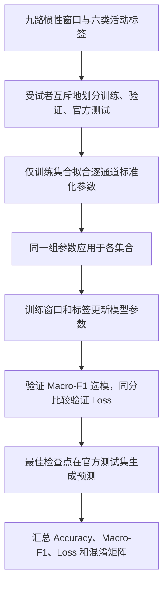

# 第四次学习规划归档勘误 · 2026-11-23

本页补充已发布 [13 页 PDF](../reports/fourth_plan_final_archive_20261123/report.pdf)、[LaTeX](../reports/fourth_plan_final_archive_20261123/questions.tex)与[逐题台账](../reports/fourth_plan_final_archive_20261123/question_mapping.csv)的阅读和证据说明。原发布版本与 [SHA-256 清单](../reports/fourth_plan_final_archive_20261123/SHA256SUMS)保留。

## 第 10 题 · 复答分句与教师通过

学生复答原文为“防止尺度过大给优化带来困难。不是的”。前半句回答为何适当标准化有助优化，“不是的”回答标准化是否一定降低预测误差。报告中连写的“教师确认通过”属于教师判定，原文和判定应分开读。教师明确区分优化条件改善与指标一定提高。[教学原文](../learning_notes/day01/source_transcript.md#day-01问题10最终验收) · [问题 10 索引](../learning_notes/day01/questions_01_12.md)

## 第 12 题 · 教师反馈分类

台账“教师纠正”栏中的“Day 01 同主题检查通过”应按**历史判定**解读。原教师说明学生回答正确，shuffle 只改变训练集的每轮读取顺序，重新划分才改变样本集合归属。该题无另行复测要求。保留学生原答中的“验证机”。[原始记录与批改](../learning_notes/day01/questions_01_12.md)

## 第 43 题 · 流程图

原报告使用文字箭头表达同一流程。下图是补充的流程图，依据冻结数据与历史评价协议。

[数据与评估协议](data_protocol.md) · [结果来源与实验注册表](experiment_registry.md)

## 核验边界

48 道题的连续编号、题面、说明和来源可核对。逐题教师原文覆盖仍为 PARTIAL；任务提供的总结性验收保持原登记。PDF 引用与章节按原发布版本查阅，原版无单列目录。
