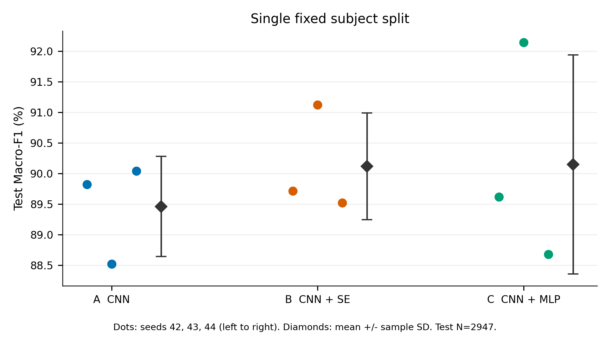
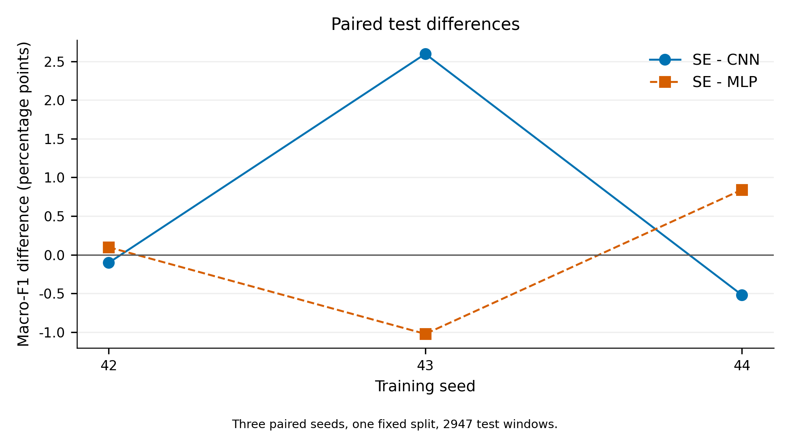
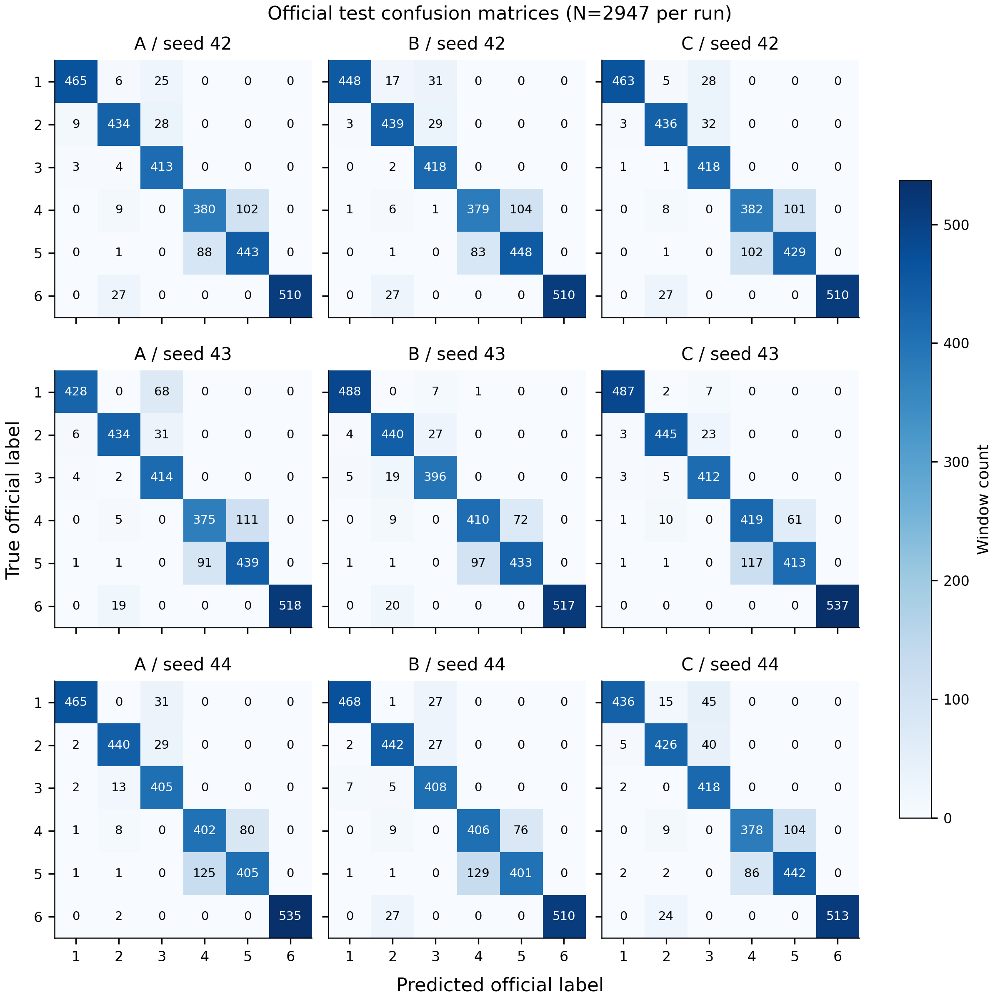
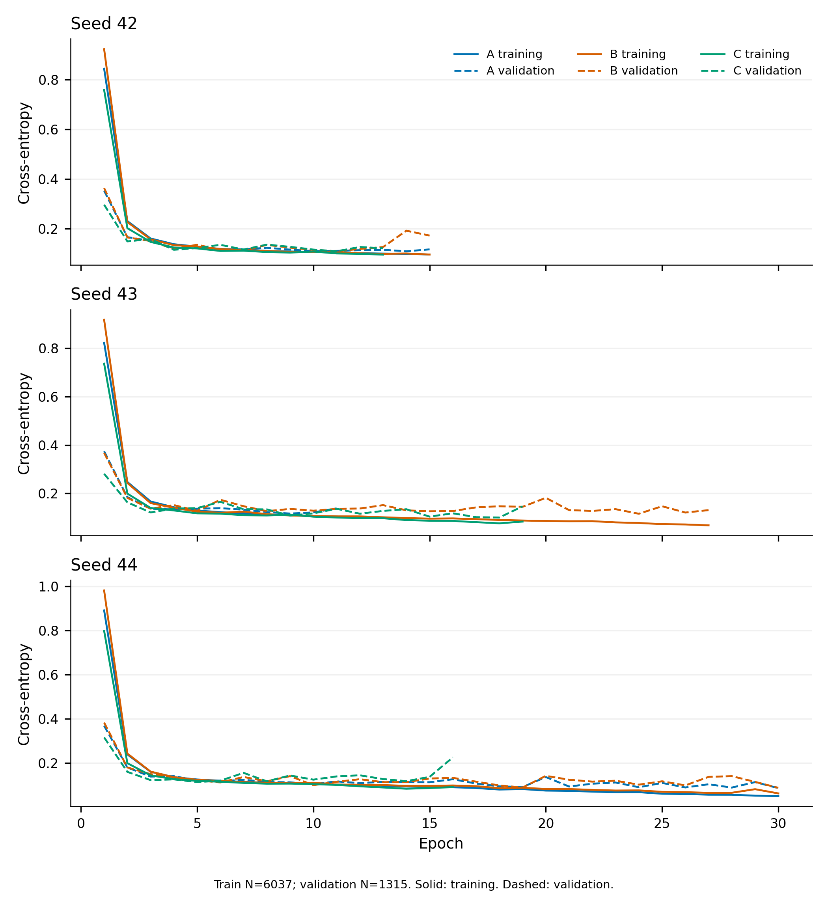
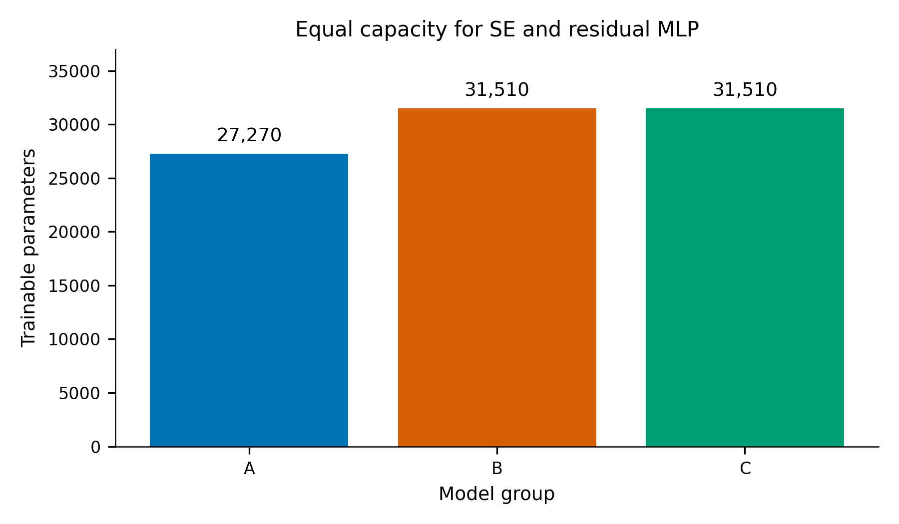

# 第五章 CNN SE / 等参数残差 MLP 消融

2026-11-22 完成 3 组 × 3 个种子的固定方案。A42 引用已核验的历史结果，另外八组完成正式训练和一次官方测试。工程结果等待教师验收。

## 协议与配对

[实施前审计](../cnn_ablation_audit_20261122/README.md)核对冻结数据、执行源码、实际日志和配置。固定训练、验证、测试为 6037/1315/2947 窗口及 17/4/9 人，沿用训练集拟合的标准化。CPU FP32、2 线程，Python 3.9.13、PyTorch 2.0.1+cpu、NumPy 1.24.4。批量 64，Adam lr 0.001、betas 0.9/0.999、eps 1e-8、weight decay 0，CrossEntropy。最多 30 轮，连续 8 轮验证选模未改善即停止。验证 Macro-F1 更高优先，完全相同才比较更低验证 Loss。训练独立 Generator 使用所在组的 seed，shuffle 开启，验证和测试顺序读取，尾批保留。无调度器、AMP、梯度裁剪、增强或类别权重。

A 使用历史两层 CNN。B 对卷积输出 [B,128,64] 沿时间取均值，通过 128→16→128 和 Sigmoid 得到逐通道系数，乘回后池化。C 在池化后经同尺寸 MLP 并残差相加。两种模块都采用带偏置的 Linear，增加 4,240 个参数，占原模型参数约 15.55%。新增层在原卷积和分类头构造后初始化，使用当前 seed 下 PyTorch Linear 的默认初始化。每个新运行先做两个真实 Batch 的梯度、更新和 Checkpoint 检查。B/C 新增参数张量各自有非零梯度且改变，正式初始状态与预检查更新前的哈希一致。

新运行记录了共享权重指纹和逐 Epoch 实际数据顺序指纹，同 seed 均与独立重建的 A 初始化及数据顺序一致。A42 的初始权重和读取顺序来自相同运行环境及原始源码的确定性重建，历史没有当时记录的指纹或 last 权重。其原始最佳模型重载证据、测试和独立复算均可核对。

## 九组测试结果与成本

| 运行 / 逐轮 CSV | Accuracy | Macro-F1 | Loss | 参数 | 最佳 / 实际轮数 | 进程秒 | Epoch 循环秒 |
| --- | ---: | ---: | ---: | ---: | ---: | ---: | ---: |
| [A42](../cnn_baseline_seed42_20261119_run01/training_history.csv) | 89.7523% | 89.8202% | 0.290570 | 27270 | 7 / 15 | 40.138 | — |
| [B42](cnn_ablation_B_seed42_20261122_run01/training_history.csv) | 89.6505% | 89.7161% | 0.318310 | 31510 | 7 / 15 | 31.414 | 25.935 |
| [C42](cnn_ablation_C_seed42_20261122_run01/training_history.csv) | 89.5148% | 89.6185% | 0.293089 | 31510 | 5 / 13 | 27.493 | 22.176 |
| [A43](cnn_ablation_A_seed43_20261122_run01/training_history.csv) | 88.4968% | 88.5241% | 0.302216 | 27270 | 3 / 11 | 22.834 | 17.593 |
| [B43](cnn_ablation_B_seed43_20261122_run01/training_history.csv) | 91.0757% | 91.1212% | 0.314798 | 31510 | 19 / 27 | 55.496 | 50.062 |
| [C43](cnn_ablation_C_seed43_20261122_run01/training_history.csv) | 92.0597% | 92.1449% | 0.296546 | 31510 | 11 / 19 | 36.023 | 30.753 |
| [A44](cnn_ablation_A_seed44_20261122_run01/training_history.csv) | 89.9898% | 90.0424% | 0.428530 | 27270 | 26 / 30 | 57.005 | 51.620 |
| [B44](cnn_ablation_B_seed44_20261122_run01/training_history.csv) | 89.4130% | 89.5221% | 0.432817 | 31510 | 26 / 30 | 60.297 | 54.940 |
| [C44](cnn_ablation_C_seed44_20261122_run01/training_history.csv) | 88.6664% | 88.6817% | 0.356325 | 31510 | 8 / 16 | 32.987 | 27.752 |

进程耗时包含 Python 启动和结束评价。八个新运行包含集成预检查，历史 A42 的预检查独立执行。新运行的 Epoch 循环包含批次哈希、训练、验证及最佳权重写入，因此也不等于纯计算时间。历史 A42 没有同口径循环计时。本次没有独立推理计时。Seed44 A/B 同为 30 轮，记录的循环耗时分别为 51.620 和 54.940 秒，观察差约 3.320 秒。整次训练成本还随实际轮数变化，不能用表中的总墙钟时间推导严格的架构速度差。

## 三种子汇总

| 组 | 平均测试 Macro-F1 | 样本标准差（百分点） |
| --- | ---: | ---: |
| A CNN | 89.4623% | 0.8200 |
| B CNN + SE | 90.1198% | 0.8726 |
| C CNN + 残差 MLP | 90.1484% | 1.7914 |

| Seed | B−A（百分点） | B−C（百分点） |
| --- | ---: | ---: |
| 42 | −0.1041 | +0.0976 |
| 43 | +2.5970 | −1.0238 |
| 44 | −0.5204 | +0.8404 |
| 配对均值 | +0.6575 | −0.0286 |

SE 对 A 的平均提升由 Seed43 驱动，三个种子只有一个提高。SE 对等参数 MLP 两个种子为正、一个为负，平均低 0.0286 个百分点，现有结果不足以支持稳定优势。三次只反映同一个受试者划分上的训练随机性。样本标准差为 n−1 定义，图中误差线表达这三次波动。

## 类别与实验解释

跨种子描述性平均 F1 中，B 相对 A 的提升较多出现在步行（+1.83 个百分点）、下楼（+1.73）、坐（+1.39）和站（+0.86），上楼（−1.04）及躺（−0.83）下降。B 相对 C 的步行（+0.56）、坐（+0.55）和站（+0.25）小幅更高，躺（−0.73）、上楼（−0.61）和下楼（−0.19）更低。完整每组每个 seed 的 P/R/F1/Support 见逐类 CSV。类别差异不证明 SE 特定机制导致改善。SE 和等参数 MLP 的模块位置与运算不同，参数量匹配只控制可训练参数个数。以当前结果，新增参数和训练成本可量化，尚无稳定的性能收益可用来证明 SE 值得采用。

行是真值，列是预测，标签 1–6 依次为 WALKING、WALKING_UPSTAIRS、WALKING_DOWNSTAIRS、SITTING、STANDING、LAYING。

## 证据与限制

- [实际命令、时间、退出码](run_commands.json)含历史 A42。八个新训练退出 0。预检查、最佳/最后权重加载及验证回放通过，固定 Probe 重载最大差 0。权重记录位于各运行目录的 checkpoint_reload_verification.json，包含路径、字节、SHA-256。权重和原始 stdout 保存在本地忽略目录。
- [检查命令与本地日志哈希](check_commands.json)记录八次训练的 stdout 哈希、三次独立核验以及图表与文档检查。16 项 PyTorch 测试、25 项数据契约测试和文档检查通过。
- [Seed42 独立复核](independent_seed42.json) · [Seed43 独立复核](independent_seed43.json) · [Seed44 独立复核](independent_seed44.json)。从已存预测复算混淆矩阵、Accuracy、Macro-F1 和逐类指标，回放验证选模及 Early Stopping。测试 Loss 为原始推理记录值，类别预测无法重构该值。
- [全量指标表](results.csv) · [逐类 CSV](per_class.csv) · [配对 CSV](paired.csv) · [统计 JSON](statistics.json) · [复现入口](reproducibility.md) · [图表及哈希](figure_manifest.json) · [变更清单](changed_files.json)。
- 审计辅助入口首次将自身列作未追踪冲突，修正白名单后通过。正式训练无失败，PyTorch 的 TypedStorage 弃用警告未影响执行。图表发布 300 dpi PNG，PDF 和 SVG 留在本地，已检查渲染。Icarus 机械检查脚本缺失，未执行该项。
- 输入数据、既有 CNN/GRU/Transformer 科学报告以及原 .gitignore 的哈希核验通过。后续适宜先由教师复核配对统计和证据，再决定是否引入独立受试者划分验证。
