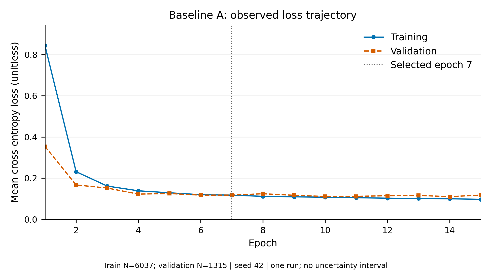
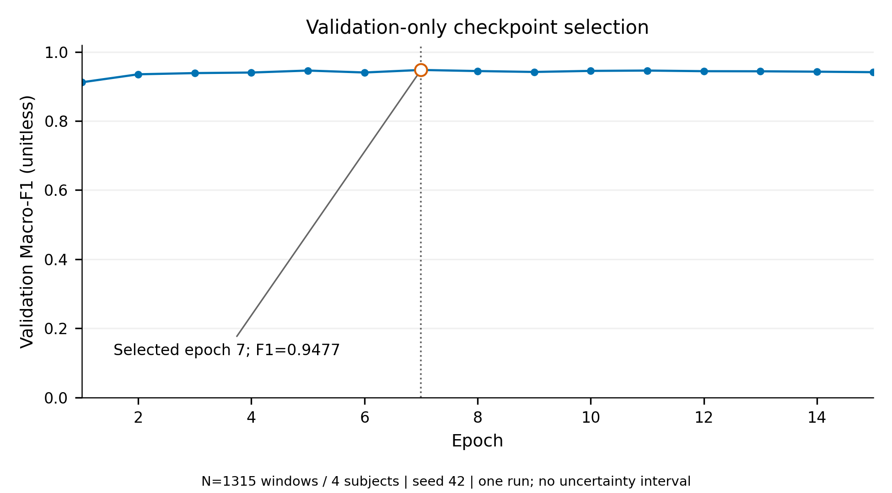
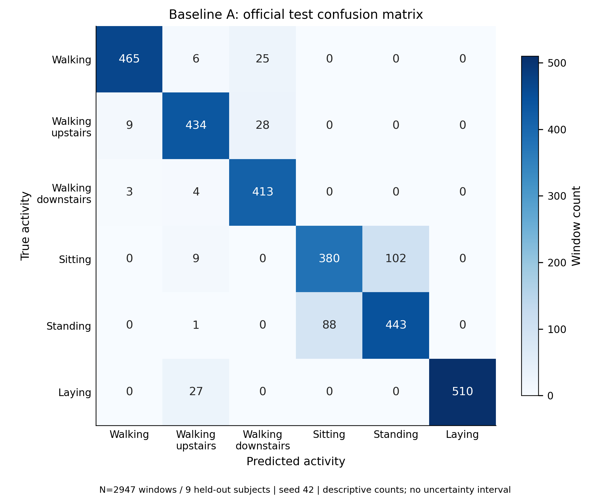

# Day 02｜CNN Baseline A · Seed 42正式训练

运行ID：cnn_baseline_seed42_20261119_run01；日期：2026-11-19。**正式训练与工程核验通过，等待ChatGPT教师验收，不宣布Day 02全部完成。**

## 审计与来源

开始时main HEAD为786e0ee93528991d4145b917b04936b3ba8f7982，remote为用户指定HTTPS仓库。既有4项无关未追踪内容经用户明确授权原样移入本地logs备份目录，266个文件移动前后SHA-256一致，未进入Git提交。

读取现有最小CNN、模型测试、Day 01报告、固定划分、训练参数、忽略规则及环境。严格使用data/processed/day01_data_20261026_run02_audit02/，训练6037、验证1315、测试2947，受试者互不重叠。29个原始文件哈希匹配，三集合全部保存值再次逐值核对原始信号与已存标准化参数一致。无重新下载、划分、拟合或写入数据。本阶段测试数据仅做只读完整性核查，没有模型预测和性能评价。[审计证据](data_audit.json)。

## 结构、公式与实测形状

独立[Baseline A实现](../../src/har_lab/cnn_baseline_a.py)复用旧模型卷积和分类层，在第一层ReLU后增加MaxPool1d(2)，旧最小CNN文件不变。不含SE、额外MLP、Dropout、BatchNorm或增强。

| 阶段 | 实测形状 B=64 | 参数公式 | 实际参数 |
| --- | --- | --- | ---: |
| 输入 | [64,9,128] | — | 0 |
| Conv1 + ReLU | [64,64,128] | 64×(9×3+1) | 1792 |
| MaxPool1d(2) | [64,64,64] | 无可训练参数 | 0 |
| Conv2 + ReLU | [64,128,64] | 128×(64×3+1) | 24704 |
| 时间平均 + Flatten | [64,128] | — | 0 |
| Linear | [64,6] | 6×(128+1) | 774 |
| 合计 | [B,6] logits | 1792+24704+774 | **27270** |

两层卷积K3/S1/P1/D1、bias=True；分类层有偏置。AdaptiveAvgPool1d(1)+Flatten等价于沿时间求平均。原始标签1–6只在内存映射为0–5，数据不变。[模型摘要](model_summary.json)。

## 冻结配置与真实预检查

[config.json](config.json)在正式训练前保存，SHA-256：e6d6d9fe4b3684e7bed0d202e3fe9969a7c64249da8312263f35cb2c844ea3eb。seed42、batch64、Adam、lr0.001、max30、patience8、drop_last=False、CrossEntropyLoss；训练shuffle=True，验证/测试不shuffle或更新。Adam betas=(0.9,0.999)、eps=1e-8、weight_decay=0；无scheduler、类别权重、正则模块或增强。

主选模指标为验证Macro-F1，严格更高即改善；数值完全相同才比较更低Loss，两者相同保留较早模型。改善重置patience，无改善计数加1，连续8轮停止。

实际Python3.9.13、PyTorch2.0.1+cpu、NumPy1.24.4，CPU、2线程、num_workers=0。固定Python/NumPy/PyTorch种子、启用确定性算法，禁用cuDNN benchmark。代码含CUDA种子设置，但本机PyTorch无法用CUDA。[环境](environment.json)。

[preflight.json](preflight.json)：两个真实Batch的形状、标签、logits及有限Loss通过；每个参数张量梯度存在、有限且有非零元素；Adam更新了全部参数张量；checkpoint重载eval输出差0。预检查模型与优化器随后丢弃，正式训练重置所有RNG并重新初始化，不带入预检查更新。

## 实际训练与验证

每Epoch95个Batch、6037窗口全部遍历，末批21样本不丢弃。训练Loss按样本加权，来自训练中持续更新的模型，不是Epoch结束固定权重的训练集重测。验证eval/no_grad，无optimizer.step。Macro-F1固定六类均值，零分母按0；混淆矩阵行是真值、列是预测。

| 项目 | 实际值 |
| --- | ---: |
| 完成Epoch | 15 |
| optimizer.step总数 | 1425 |
| 最佳Epoch | 7 |
| 最佳Epoch Training Loss | 0.117326844639 |
| 最佳Validation Loss | 0.117469466860 |
| 最佳Validation Accuracy | 0.949049429658 |
| 最佳Validation Macro-F1 | 0.947689541535 |
| 第15轮Training Loss | 0.096826498087 |
| 停止原因 | 连续8轮选模标准未改善，patience停止 |
| 训练进程总耗时 | 40.138秒，含启动及最终评价 |
| 内部训练及结束核验计时 | 35.392秒 |

Epoch14验证Loss低于Epoch7，但Macro-F1更低，因此不替换最佳模型。[逐轮CSV](training_history.csv)包含全部要求的指标、学习率、最佳Epoch和patience计数。每次更新分别新建epoch文件，不覆盖已有权重。

## 最佳权重与最终测试

严格重新加载相同结构，保存时的固定验证probe在eval/no_grad下逐值一致，最大绝对差0；完整验证回放Loss和Macro-F1也完全一致。[重载证据](checkpoint_reload_verification.json)。

最佳checkpoint仅本地保存：checkpoints/cnn_baseline_seed42_20261119_run01/epoch_007.pt；111635 bytes；SHA-256：55b03a82d8075ab12f563acd2edf95cecca5e99090d229263f50dac1a2171fd5。weights_only受限加载，含权重、epoch、配置哈希及验证probe logits，不含Adam状态，因此不提供中断恢复训练功能。

随后仅最佳Checkpoint在官方测试集执行**1次模型评价**。未用测试结果改Epoch、种子或配置；独立复核只读保存CSV，不再执行测试推理。

| 指标 | 实际值 |
| --- | ---: |
| 测试窗口数 | 2947 |
| Accuracy | 0.897522904649 |
| Macro-F1 | 0.898201856179 |
| CrossEntropyLoss | 0.290570255924 |

| 活动 | Precision | Recall | F1 | Support |
| --- | ---: | ---: | ---: | ---: |
| WALKING | 0.9748 | 0.9375 | 0.9558 | 496 |
| WALKING_UPSTAIRS | 0.9023 | 0.9214 | 0.9118 | 471 |
| WALKING_DOWNSTAIRS | 0.8863 | 0.9833 | 0.9323 | 420 |
| SITTING | 0.8120 | 0.7739 | 0.7925 | 491 |
| STANDING | 0.8128 | 0.8327 | 0.8227 | 532 |
| LAYING | 1.0000 | 0.9497 | 0.9742 | 537 |

完整精度见[test_metrics.json](test_metrics.json)、[per_class_metrics.csv](per_class_metrics.csv)。[混淆矩阵CSV](confusion_matrix.csv)、[逐官方测试行预测](test_predictions.csv)支持复算。独立标准库指标重算及固定NPZ标签核对误差不超过1e-14，同时回放选模和Early Stopping，不进行第二次模型评价。[独立核验](independent_result_verification.json)。

SITTING→STANDING102个、STANDING→SITTING88个，是本次主要错误之一；LAYING也有27个预测为上楼。上述只描述结果，不证明具体成因，没有据此调参或重训。

## 命令、图表与异常

[commands.json](commands.json)记录实际命令、起止时间、耗时和退出码。[local_log_manifest.json](local_log_manifest.json)记录本地stdout日志大小/SHA-256。正式日志路径：logs/cnn_baseline_seed42_20261119_run01/04_training.log。数据、权重、原始日志、venv及备份按既有.gitignore留本地，忽略规则没有修改。

本地7项PyTorch测试、25项标准库数据契约测试均通过；最终文档检查覆盖22页和209条本地引用并通过。既有轻量GitHub CI不运行正式训练，不能替代本轮真实训练证据。

三图从真实CSV生成，采用既有样式，PNG300dpi和可编辑PDF/SVG；已实际打开三图检查文字、坐标、数值、图例。[图表清单](figure_manifest.json)含源文件及图表哈希、尺寸/dpi。[图表质量记录](figure_quality.md)明确单种子无置信区间。Icarus技能安装目录缺少paperfig和critique.py，机械门禁不可用，未声称通过；沿用已存在的项目样式并执行本地视觉检查。

正式训练与预检查无失败、NaN/Inf或维度/梯度异常，没有改配置重跑。TypedStorage弃用警告不影响退出0，未为消除警告更改依赖。最初只读沙箱无法启动进程，后经授权在沙箱外执行，属于运行权限处理，不是训练失败。

暂存区格式检查曾退出2：生成SVG路径含合法行尾空格，训练脚本也有一处行尾空格。为本轮SVG增加精确范围的.gitattributes规则，保留矢量原字节和已记录哈希；源码只清除该空格。实际执行源码原字节备份在本地logs，原执行哈希、公开源码哈希和Python AST完全相同的核对记录已追加到source_provenance.json。没有重新训练或测试，.gitignore未变。失败检查及修复后检查分别保留，不把首次检查写成通过。

## 复现、Git与局限

[复现说明](reproducibility.md)与[学习补充](../../learning_notes/day02/2026-11-19_cnn_baseline_a.md)提供命令和待讨论问题。[changed_files.json](changed_files.json)是本轮提交文件清单。只提交代码、配置、汇总/预测CSV、图表、报告与笔记；不提交原始窗口、权重、认证文件或stdout。推送后的SHA和状态保存到本地logs/cnn_baseline_seed42_20261119_run01/sync_receipt.json并在最终交付返回，避免在commit内嵌它自身SHA。

只有单种子与单CPU环境，没有多种子均值/方差或跨设备验证。相邻窗口重叠，窗口N不能当作独立受试者N；验证高于测试不说明错误的具体原因。本轮未训练GRU、Transformer、Mamba，未执行SE或等参数MLP消融；Day 02整体是否通过由教师决定。
