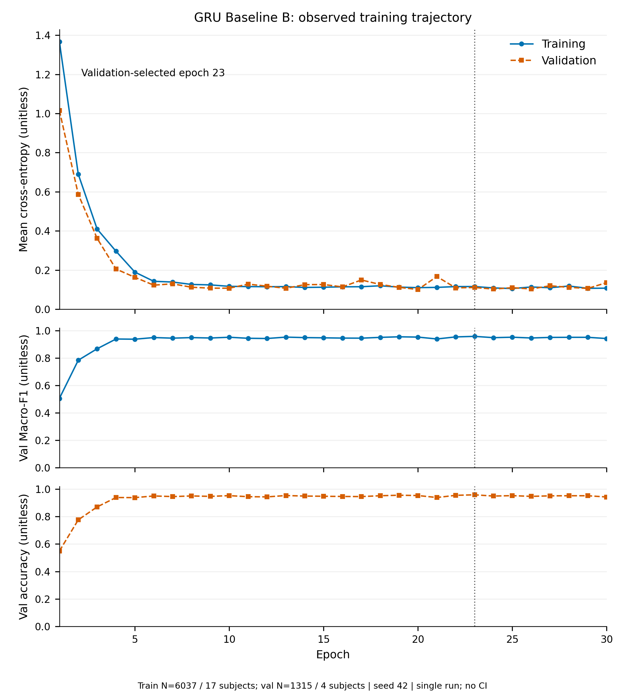
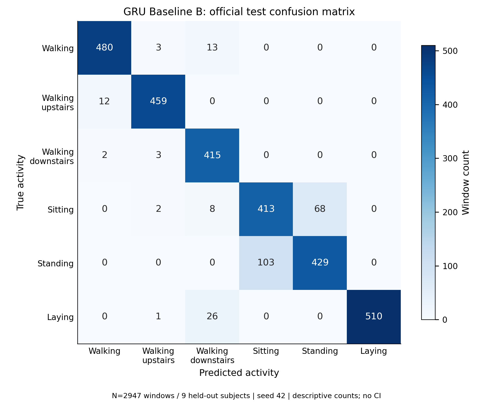

# GRU Baseline B｜真实训练、独立测试与归档

运行ID：gru_baseline_seed42_20261121_run01。2026-11-21执行；工程结果待教师验收，不自行宣布Day 02全部通过。

## 配置审计与数据

先完成[实施前CNN审计](../gru_baseline_preflight_20261121/audit_report.md)，再新增GRU代码。配置SHA、执行源码快照、CNN原始stdout/CSV、环境及冻结产物均核对；关键条件可恢复，无阻塞缺失。隐含参数按实际PyTorch2.0.1实现恢复，不把经验默认值冒充记录。旧CPU型号/序列号未保存，不能独立验证硬件指纹，但当前平台、解释器、CPU设备及依赖与CNN记录逐字段相同。

数据直接复用data/processed/day01_data_20261026_run02_audit02/；训练6037、验证1315、测试2947，人员独立，验证ID1,3,5,6。当前数据、原始文件、划分和训练集标准化参数哈希与CNN审计一致；不下载、改划分或重拟合。磁盘官方标签1–6仍保留，加载时复用原映射减1为0–5。GRU使用已存[B,128,9]，不改数据来适配CNN布局。[原数据协议](../../docs/data_protocol.md)。

## 实际模型与必要检查

GRU(input_size9, hidden_size64, num_layers1, batch_first=True, bidirectional=False, bias=True, dropout0)，隐式全零h0，h_n[-1]→Linear64→6。没有额外卷积、注意力、双向或其他模块。

| 阶段 | 集成检查实际形状 B=64 |
| --- | --- |
| 输入 | [64,128,9] |
| GRU完整序列输出 | [64,128,64] |
| h_n | [1,64,64] |
| 最终隐藏状态与分类层输入 | [64,64] |
| logits | [64,6] |

参数：3×64×9 + 3×64×64 + 2×3×64 + (64×6+6) = **14790**，公式与实测一致。[模型摘要](model_summary.json)。PyTorch为三个门分别保存输入/隐藏权重及两套偏置。

不单独建立GRU最小实验。入口内部用一次性测试模型检查两个真实Batch：输入/标签/logits合法，Loss有限，全部参数张量梯度存在、有限且有非零元素，Adam确实更新全部参数；正式模型/优化器和loader随后重新按固定种子初始化。[集成检查](integrated_preflight.json)。

## 固定训练条件与真实运行

[config.json](config.json)在更新参数前保存：seed42、batch64、Adam lr.001/betas(.9,.999)/eps1e-8/weight_decay0；amsgrad/maximize/capturable/differentiable=False，foreach/fused=None。CrossEntropy weight=None/ignore_index=-100/label_smoothing0，训练mean、评价sum除N。无AMP、梯度裁剪、调度器、权重加权或增强。

CPU FP32、2线程、workers0、pin_memory=False、drop_last=False；训练shuffle，验证/测试顺序读取。Python/NumPy/PyTorch/loader种子均42，确定性算法启用，cuDNN benchmark关闭。实际optimizer参数、dtype和loader状态另存[runtime_conditions.json](runtime_conditions.json)。

入口进程开始：2026-11-21T21:14:46.934337+08:00；结束：2026-11-21T21:18:38.457182+08:00；退出码0；墙钟231.527秒。该区间含集成检查及最终评价。正式训练/验证循环另计223.954秒。没有分别记录模型推理耗时，不补造。

| 项目 | 真实值 |
| --- | ---: |
| 实际Epoch | 30 |
| 最佳Epoch | 23 |
| 最佳验证Macro-F1 | 0.957861707238 |
| 最佳验证Loss | 0.110840032122 |
| 最佳验证Accuracy | 0.958935361217 |
| Adam更新数 | 2850 |
| 停止原因 | max_epochs |
| 最后连续未改善计数 | 7 |

每轮95批、6037窗口，包括21样本尾批。train Loss和train Accuracy来自参数持续更新时的Batch输出，不等于Epoch后固定模型重测。验证eval/no_grad不更新；按Macro-F1严格更高优先，完全相同才比较更低Loss，两者都相同保留早期；8轮未更新最佳则停止。没有按测试集成绩选模。[逐轮记录](training_history.csv)包含训练Loss/Accuracy、验证Loss/Accuracy/Macro-F1、lr、秒数、最佳Epoch及patience计数。

## 最佳与最后Checkpoint

best与last均strict、weights_only重新加载，固定验证probe输出最大差为0；best完整验证回放与选模记录完全相同。[核验](checkpoint_reload_verification.json)。每次改善使用新的epoch文件，另有字节相同的best_checkpoint别名；last单独保存，不覆盖旧运行。

- best：checkpoints/gru_baseline_seed42_20261121_run01/best_checkpoint.pt；61587 bytes；SHA-256：3c21fc23bd9bb9853e81a1aa3f07951a845968e193ed31bd869f129b34c40abf
- last：checkpoints/gru_baseline_seed42_20261121_run01/last_checkpoint.pt；61143 bytes；SHA-256：0bd1677855d33c9a4e3fa90e1d22c116b8892da4ac409555625ad2abe68932ba

以上权重按既有.gitignore留本地。保存seed、epoch及配置SHA，完整配置在报告；不含Adam状态，不宣称支持中断恢复训练。

## 唯一一次最终测试

仅最佳模型结束后eval/no_grad评价官方独立测试集一次；测试loader不参与训练和选模。结果保存后没有改参数、重选Epoch、换种子或重新训练。

| 指标 | 实际值 |
| --- | ---: |
| Test Accuracy | 0.918221920597 |
| Test Macro-F1 | 0.919444217560 |
| Test Loss | 0.255318629264 |
| 窗口数 | 2947 |

| 活动 | Precision | Recall | F1 | Support |
| --- | ---: | ---: | ---: | ---: |
| WALKING | 0.971660 | 0.967742 | 0.969697 | 496 |
| WALKING_UPSTAIRS | 0.980769 | 0.974522 | 0.977636 | 471 |
| WALKING_DOWNSTAIRS | 0.898268 | 0.988095 | 0.941043 | 420 |
| SITTING | 0.800388 | 0.841141 | 0.820258 | 491 |
| STANDING | 0.863179 | 0.806391 | 0.833819 | 532 |
| LAYING | 1.000000 | 0.949721 | 0.974212 | 537 |

完整精度见[metrics.json](metrics.json)、[classification_report.json](classification_report.json)、[per_class_metrics.csv](per_class_metrics.csv)。Macro-F1固定六类等权，零分母为0；矩阵行真值/列预测。[混淆CSV](confusion_matrix.csv)、[逐官方测试行预测](test_predictions.csv)。

独立核验只读取保存预测与固定官方标签，重新计算分类指标/矩阵并回放选模和patience，误差≤1e-14；不再次运行模型。Test Loss是原forward实际计算值，不声称从argmax标签独立复算Loss。还逐Batch检查GRU首次Epoch与CNN加载器交换布局后数据和标签完全相同。[独立证据](independent_verification.json)。

## CNN对比与限制

[完整CNN—GRU比较](cnn_gru_comparison.md)列出真实指标、参数、Epoch和计时边界，详细讨论SITTING/STANDING及其他错误。单种子不能宣称普遍优越；结构、参数量及计算差异不构成已隔离的机制因果证据。旧CNN没单独记录推理时间/训练循环时间，明确留空，不为补计时而重跑旧模型。

## 工程归档、异常与Git

[实际命令/退出码](commands.json)、[本地日志哈希](local_log_manifest.json)、[产物清单](artifact_manifest.json)、[文件变更清单](changed_files.json)、[复现说明](reproducibility.md)。完整stdout仅本地logs/gru_baseline_seed42_20261121_run01/02_training.log。源码/配置/输入哈希见[source_provenance.json](source_provenance.json)。

本地10项PyTorch项目测试、25项标准库数据契约测试通过；文档检查28页、279条本地引用通过。初始CNN审计命令的退出码和工具耗时已记录，但没有捕获墙钟起止时间，commands.json明确标为null；正式训练及后续命令均有完整起止/耗时记录，不补造缺失时间。既有轻量CI不执行正式数据训练，不能用其状态替代真实运行证据。

训练无NaN/Inf、梯度/形状错误，无调整配置重训。PyTorch现有TypedStorage弃用警告在Checkpoint操作时出现，退出0；没有更换依赖。图表使用既有共享样式，PNG300dpi和PDF公开，可编辑SVG留本地outputs；已查看两张PNG。Icarus安装目录缺少机械critique.py，门禁未运行、不记为通过；不为修图改数据或模拟曲线。图表源CSV与全部生成文件哈希在[figure_manifest.json](figure_manifest.json)。

首版训练曲线的选中Epoch说明与图例重叠，视觉审查未通过。首版公开副本、清单和绘图源码原样移至本地logs/gru_baseline_seed42_20261121_run01/figure_attempt01/并核对哈希，原outputs首版也保留。仅调整文字位置，按layout02新目录重绘；最终图已复查。该修复不改变CSV、训练代码、指标或Checkpoint，没有重训或第二次测试。首版程序成功生成不等于视觉验收通过，两类状态分别记录。

只提交本次代码、测试、配置、指标/预测CSV、图表、报告及当前导航；原始窗口、数组、权重、stdout、venv和认证不提交。.gitignore及CNN历史结果/源码/Checkpoint/日志保持不变；提交前对照冻结哈希。推送和远端SHA结果保存本地logs/gru_baseline_seed42_20261121_run01/sync_receipt.json并在最终交付返回，避免把本commit自身SHA嵌入它自身。

本轮只执行GRU；未训练Transformer/Mamba或任何消融。GRU工程结果交由教师审核，Day 02整体不自动判定完成。
