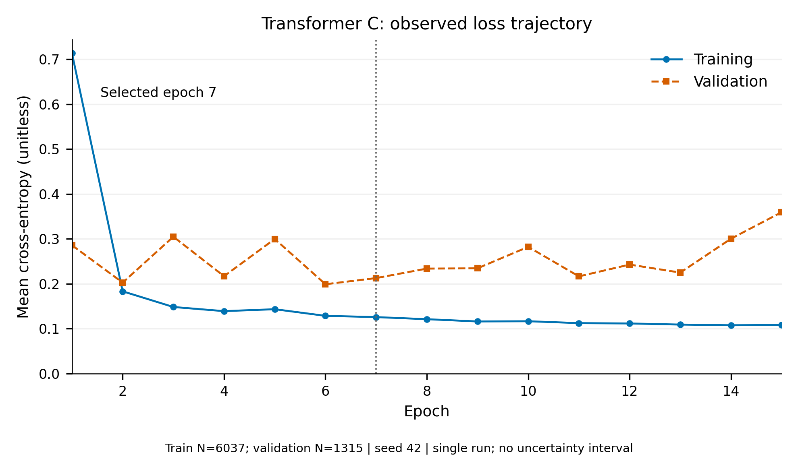
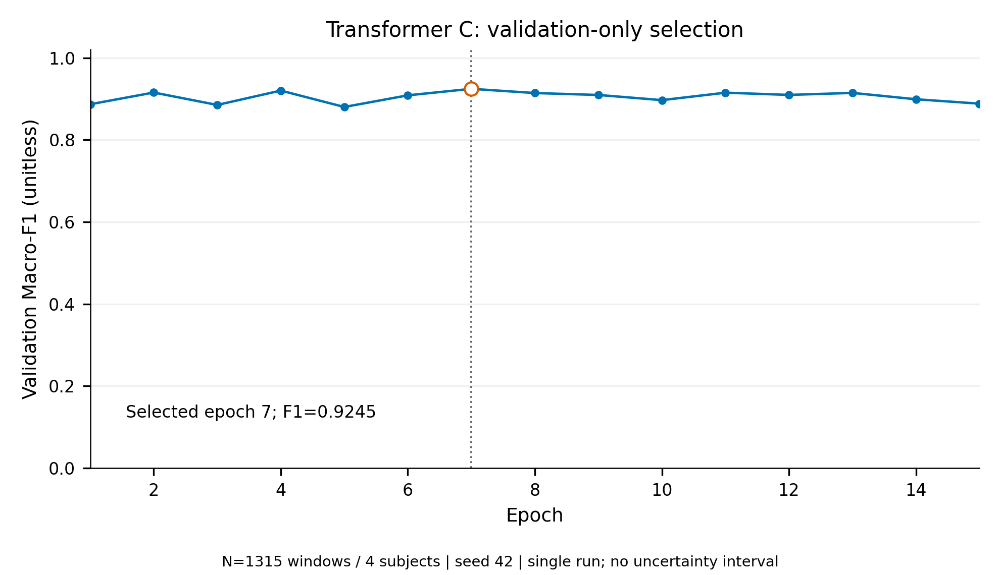
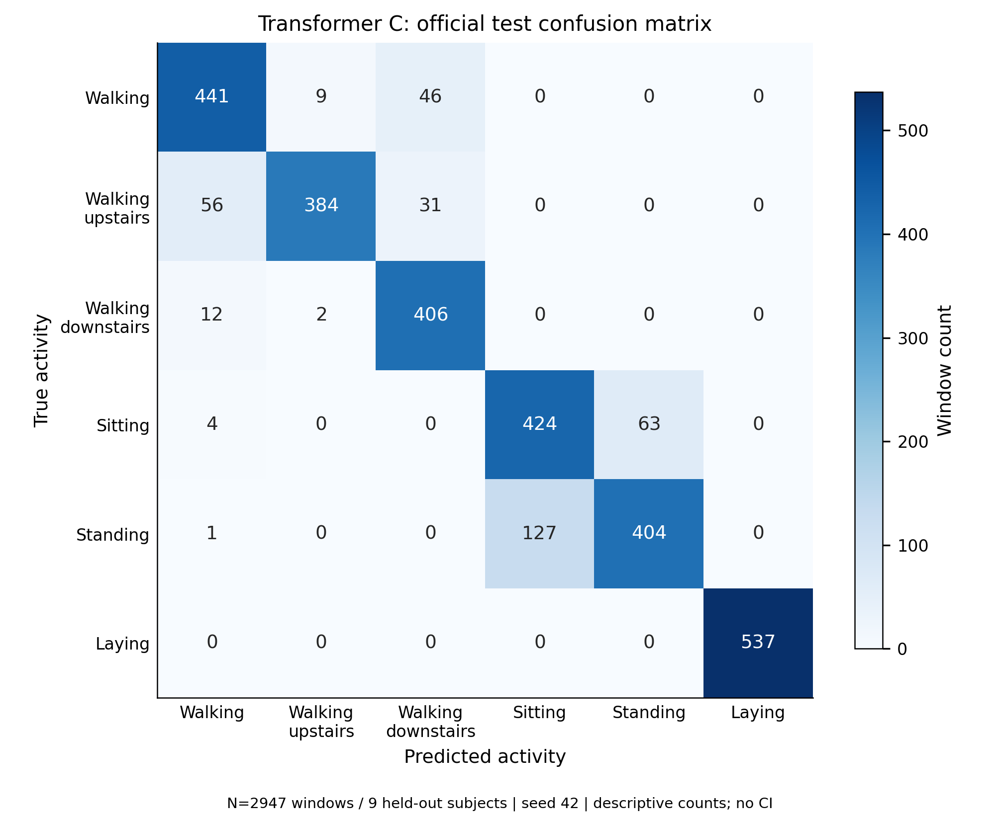

# Transformer Baseline C｜真实训练与最终评价

运行ID：transformer_baseline_seed42_20261122_run01。用户授权的正式实验，结果等待教师验收，不宣布第四次学习规划整体完成。

## 审计、数据与环境

先完成[只读审计](../transformer_preflight_20261122/audit_report.md)，开始时main干净、HEAD d2fbdfc5d9f07fd3a382de7a5ad45235c73b6020。CNN和GRU配置、源码、stdout、结果和权重字节哈希核对通过。没有移动、删除或覆盖任何既有文件、未追踪文件及历史实验。

复用day01_data_20261026_run02_audit02：train6037/17人、validation1315/4人、test2947/9人；val=1,3,5,6；test=2,4,9,10,12,13,18,20,24，三组不交叉。磁盘标签int64 1–6，复用既有映射给CE输入long 0–5。全量数组/原始29文件/划分/训练集标准化参数哈希一致，当前NPZ形状、标签、人员和有限值实查通过；不下载、改划分或重新拟合。旧数据源与采样/通道说明见[Day 01协议](../../docs/data_protocol.md)。

实际Python3.9.13、PyTorch2.0.1+cpu、numpy1.24.4、CPU FP32、2线程。[environment.json](environment.json)与[runtime_conditions.json](runtime_conditions.json)分别记录软件及真实optimizer/线程/dtype/loader条件。原CNN未记录硬件序列号，不能独立复核硬件指纹，只确认当前记录的平台/解释器/CPU版本一致。

## 结构与参数

输入[B,128,9]→Linear9→64→固定正弦编码→单层Transformer Encoder→时间均值→Linear64→6。Encoder严格为d_model64、head4、FF128、ReLU、dropout0、batch_first=True、norm_first=False，标准Post-Norm、LayerNorm eps1e-5。无CLS token、额外最终Norm、输入缩放、SE、卷积、GRU或其他模块；全窗口注意力无因果/填充mask。

位置编码为PE(pos,2i)=sin(pos/10000^(2i/64))，PE(pos,2i+1)=cos(pos/10000^(2i/64))，pos=0..127；[1,128,64]固定持久buffer，非可训练参数。标准Encoder的nested tensor优化选项保持默认True，本任务固定长度且无padding mask，不改变模型协议。

| 部分 | 参数计算 | 实际参数 |
| --- | --- | ---: |
| 输入投影 | 64×(9+1) | 640 |
| Q/K/V投影 | 3×64×(64+1) | 12480 |
| 注意力输出投影 | 64×(64+1) | 4160 |
| FFN第一层 | 128×(64+1) | 8320 |
| FFN第二层 | 64×(128+1) | 8256 |
| 两个LayerNorm | 2×2×64 | 256 |
| 分类层 | 6×(64+1) | 390 |
| 合计 | — | **34502** |

实际形状：[64,128,9]→投影/位置/Encoder均[64,128,64]→均值[64,64]→logits[64,6]。[模型摘要](model_summary.json)记录逐参数形状、个数及buffer。

## 固定配置与真实预检查

seed42、batch64、Adam lr.001/betas(.9,.999)/eps1e-8/weight_decay0；其余Adam选项同已审计基线。CE无权重、ignore_index=-100、label_smoothing0；训练mean、评价sum/N。max30、patience8、drop_last=False，无scheduler/AMP/裁剪/增强。train shuffle=True，val/test False；workers0、pin_memory/persistent_workers=False；独立loader Generator42。Python/NumPy/PyTorch种子42，确定性算法启用，cuDNN benchmark关闭。[固定配置](config.json)。

两个真实训练Batch检查输入/long标签/logits、有限CE、全部参数梯度存在且有限、总梯度非零、Adam更新及Checkpoint重载通过，eval输出最大差0.0。PE buffer不随更新改变。丢弃检查模型/optimizer，重置全部RNG并重新建正式模型与loader；正式初始state_dict哈希和检查更新前初始哈希一致，证实未继承检查更新。[预检查证据](integrated_preflight.json)。

## 实际训练、选模与停止

入口开始：2026-11-22T13:23:46.863881+08:00；结束：2026-11-22T13:26:56.614036+08:00；退出码0；进程墙钟189.754秒，包含预检查/初始化/最终核验和测试；训练验证循环180.396秒，含每次最佳写盘。

| 项目 | 实际值 |
| --- | ---: |
| 最佳Epoch | 7 |
| 实际Epoch | 15 |
| 最佳Val Macro-F1 | 0.924534494168 |
| 最佳Val Loss | 0.212649462160 |
| 最佳Val Accuracy | 0.926235741445 |
| 停止原因 | patience |
| 最后未改善计数 | 8 |
| Early Stopping触发 | True |
| 正式optimizer.step次数 | 1425 |

每Epoch95批、完整6037样本，尾批21不丢。训练Loss/Accuracy来自更新过程中的批次输出，不是结束后固定模型重测。验证eval/no_grad不更新，复用原six-class Macro-F1、zero_division0、improves规则：F1严格更高，完全相同才比较更低Loss，两者完全同保留较早。连续8次未刷新才提前停，最多30轮。[完整逐轮CSV](training_history.csv)。

## best/last与唯一一次最终测试

每次最佳更新另存epoch文件，best_checkpoint为最佳epoch字节相同副本，last单独保存。best strict/weights_only加载，固定验证probe与保存前逐值一致；完整验证回放Loss与Macro-F1也一致。last重新加载后同probe输出逐值一致。全部通过后才执行官方测试一次，没有根据测试修改Epoch、种子或配置。[重载记录](checkpoint_reload_verification.json)。

- best：checkpoints/transformer_baseline_seed42_20261122_run01/best_checkpoint.pt；176559 bytes；SHA-256：cf73d0a7d3a724bdeb93ae66f5bce7d1035c1e8f2944d67a5b778fe20f23dd2e
- last：checkpoints/transformer_baseline_seed42_20261122_run01/last_checkpoint.pt；176178 bytes；SHA-256：4b5c3acb16645df4cb3aafe43f921af1fb31eff501cbaae143c9341dcdc1b9d9

权重保留本地，包含seed/epoch/配置SHA及固定位置buffer；不含Adam状态，不声称支持中断恢复。

| 测试指标 | 实际值 |
| --- | ---: |
| Accuracy | 0.880895826264 |
| Macro-F1 | 0.880326091199 |
| Loss | 0.425904659731 |
| 样本数 | 2947 |

| 活动 | Precision | Recall | F1 | Support |
| --- | ---: | ---: | ---: | ---: |
| WALKING | 0.857977 | 0.889113 | 0.873267 | 496 |
| WALKING_UPSTAIRS | 0.972152 | 0.815287 | 0.886836 | 471 |
| WALKING_DOWNSTAIRS | 0.840580 | 0.966667 | 0.899225 | 420 |
| SITTING | 0.769510 | 0.863544 | 0.813820 | 491 |
| STANDING | 0.865096 | 0.759398 | 0.808809 | 532 |
| LAYING | 1.000000 | 1.000000 | 1.000000 | 537 |

[完整精度JSON](test_metrics.json) · [逐类CSV](per_class_metrics.csv) · [混淆CSV](confusion_matrix.csv) · [官方测试行预测](test_predictions.csv)。混淆矩阵行真值/列预测，标签顺序与CNN/GRU一致。

## 独立复核与三模型比较

复用已审阅的保存预测验证器，独立从CSV复算分类指标和矩阵、回放选择/patience/样本覆盖、核对真实官方标签与配置/源/输入/权重SHA，不做第二次推理。首次Epoch每个训练Batch与原CNN交换布局后逐值一致。Test Loss来自原forward，不伪称从argmax预测独立复算。[independent_verification.json](independent_verification.json)。

另检查固定buffer在best/last中与独立float64正弦公式一致（允许FP32计算误差1e-5）、无可训练PE参数、34502参数及批准结构、初始哈希、所有重载条件。[Transformer专用复核](transformer_contract_verification.json)。

[三模型对照](three_model_comparison.md)含完整总体/逐类指标、参数、最佳/实际轮数、三矩阵及带边界的计时。旧CNN/GRU只读；当前单Seed42，不声明显著性、普遍优越或严格速度排名。

## 证据、异常、限制与Git

[实际命令/退出码](commands.json)、[本地stdout哈希](local_log_manifest.json)、[产物清单](artifact_manifest.json)、[变更清单](changed_files.json)、[复现说明](reproducibility.md)。正式stdout：logs/transformer_baseline_seed42_20261122_run01/02_training.log。数据与配置SHA在[source_provenance.json](source_provenance.json)及实施前机器审计中。

本地14项PyTorch测试、25项标准库数据契约测试通过，文档检查34页、344条本地引用通过。初始辅助审计的工具耗时/退出码有记录，墙钟起止未捕获，commands.json明确为null；正式训练和后续检查有完整起止与耗时。轻量CI不执行正式模型训练，不以其状态替代本轮真实运行证据。

审计辅助脚本3次直接启动报源码编码错误，但原字节能按UTF-8解码和编译；显式UTF-8读取执行后审计通过，根因未确认。原辅助文件及诊断保留在logs/transformer_baseline_seed42_20261122_run01/，公开[失败与修复摘要](audit_startup_issues.json)。这不是训练数据或正式模型预检查失败；正式入口为ASCII源码，正常直接运行。没有更换依赖或修改旧成果。TypedStorage弃用警告不影响退出0。正式训练无NaN/Inf或梯度异常，未因表现改变协议或重训。

图表仅从CSV生成，PNG300dpi/PDF公开，SVG本地可编辑；已实际打开检查三图。沿用现有共享样式，[图清单](figure_manifest.json)记录源/图SHA、dpi/尺寸；Icarus机械critique.py缺失，未运行、不声称通过。单种子不绘虚假的CI。

只提交源码、测试、配置、结果、图表、报告及学习/当前导航；原始窗口、数组、权重、stdout、venv或认证不提交。.gitignore与CNN/GRU历史代码/报告/权重/日志/数据全部保持哈希。提交前diff/暂存审查，普通push，不force；推送后HEAD/远端及干净状态保存本地logs/transformer_baseline_seed42_20261122_run01/sync_receipt.json并在最终交付返回，避免在提交内自引用commit SHA。

仍限单种子、固定划分和记录的平台，历史计时/CPU指纹不完整，不能推广为多种子统计或严格硬件效率结论。未训练Mamba或做任何消融；后续由教师验收决定，不自行宣布整体完成。
